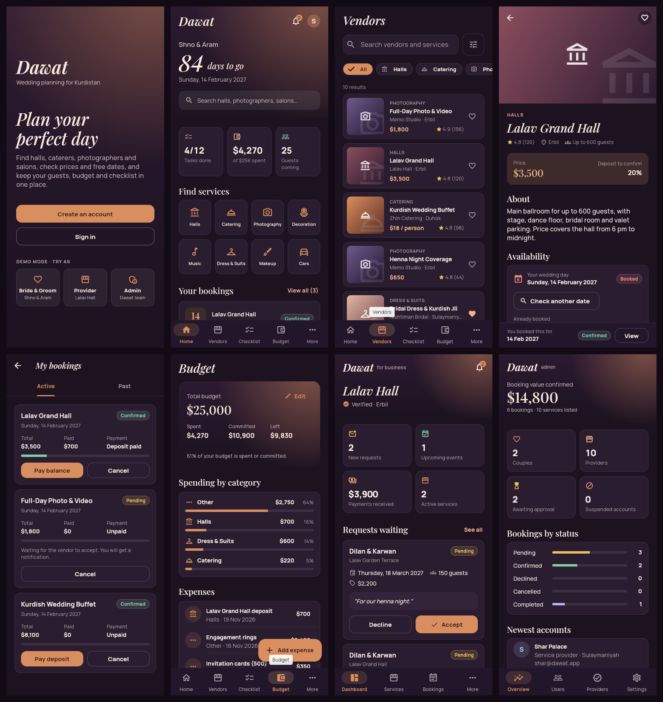

# Dawat · داوەت

A wedding planning app for Kurdistan, built with Flutter for Android and iOS
(it also runs on the web). Couples find and book halls, caterers,
photographers and salons, and keep their guests, budget and checklist in one
place. Service providers manage their listings and incoming bookings, and
admins look after users, providers and system settings.

American University of Kurdistan, Computer Science & IT.
Chiner · Zhyar · Ravin. Supervisor: Dr. Hasan Mohammed.



## Run it

You need Flutter 3.47 or newer (built and tested with 3.50.1).

```bash
flutter pub get
```

```bash
flutter run
```

The app starts in **demo mode**: it uses sample data held in memory and does
not need Firebase. The welcome screen has one-tap sign-in for each actor:

| Actor | Email | Password |
| --- | --- | --- |
| Bride & Groom | `shno@dawat.app` | `demo1234` |
| Service provider (Lalav Hall) | `lalav@dawat.app` | `demo1234` |
| Admin | `admin@dawat.app` | `demo1234` |

Demo data resets every time the app restarts.

```bash
flutter test
```

## Design: "Henna Night"

Dark-first theme: aubergine background, henna-copper accent, Playfair Display
italic for headings and Manrope for interface text. A light variant can be
picked under More → Appearance. All colors live in `lib/core/theme/app_theme.dart`
(`DawatColors` for the custom tokens).

English only for now. Kurdish (Sorani) and Arabic are planned. Kurdish is
not in Flutter's built-in localizations, so it will need fallback delegates
that use Arabic's right-to-left layout.

## How the code maps to the report

### Use cases (§7.1)

| Use case | Actor | Where |
| --- | --- | --- |
| Register Account | Couple, Provider | `ui/auth/register_screen.dart` |
| Login | All | `ui/auth/login_screen.dart` |
| Browse & Filter Services (type, city, price) | Couple | `ui/couple/vendors_tab.dart` |
| Manage Wishlist / Favorites | Couple | heart buttons, `FavoritesScreen` in `ui/couple/more_tab.dart` |
| View Prices & Availability | Couple | `ui/couple/service_detail_screen.dart` |
| Book Services & Make Payment | Couple | `BookingRequestSheet`, `ui/couple/bookings_screen.dart` (`PaymentScreen`) |
| Manage Budget & Expenses | Couple | `ui/couple/budget_tab.dart` |
| Manage Guest List & RSVPs | Couple | `ui/couple/guests_screen.dart` |
| Receive Notifications & Reminders | Couple, Provider | `ui/common/notifications_screen.dart`, `createDueReminders()` |
| Manage Services, Pricing & Incoming Bookings | Provider | `ui/provider/` |
| Manage Users, Providers & System Settings | Admin | `ui/admin/admin_shell.dart` |

Also covered from §6.4: profile editing (`ui/common/profile_screen.dart`) and
the wedding checklist from the concept screens (`ui/couple/checklist_tab.dart`).

### Class diagram (§7.2) → `lib/data/models/`

- `AppUser` is a sealed class with `Couple`, `ServiceProvider` and `Admin`
  subclasses (`app_user.dart`).
- `Service` with `checkAvailability()` (`service.dart`).
- `Booking` with status and payment status (`booking.dart`).
- `BudgetExpense`, `Guest` with `updateRsvp()`, and `ChecklistTask` (`planner.dart`).

### ER diagram (§7.3) → Firestore collections

`users` (with a `role` field), `services`, `bookings`, `wishlists`, `guests`,
`budget_expenses`, plus `tasks`, `notifications` and `settings/system`.

## Booking workflow

`lib/logic/booking_actions.dart` holds the rules shared by every screen:

1. A couple requests a date. Blocked dates can't be picked, and per-person
   prices need a guest count.
2. The provider accepts or declines. Accepting blocks that date on the
   service and auto-declines other pending requests for the same day.
3. The couple pays a 20% deposit, then the balance. Each payment is added to
   their budget as an expense.
4. The provider marks the booking completed after the event. Either side
   is notified at every step.

New providers stay hidden from couples until an admin approves them.
Suspended accounts can't sign in. Maintenance mode shows couples and
providers a notice.

## Project layout

```
lib/
  main.dart               demo or Firebase backend, then runApp
  app.dart                providers, theme, role-based routing (RootGate)
  core/theme/             Henna Night theme
  core/utils/format.dart  money, dates and English labels
  data/models/            class-diagram models
  data/repositories/      repository interfaces
  data/demo/              in-memory backend + sample data
  data/firebase/          Firebase Auth / Firestore / FCM backend
  logic/                  booking workflow, session, settings
  ui/auth|couple|provider|admin|common|widgets
test/                     models, booking workflow, widget smoke tests
firestore.rules           role-based security rules (§9.1)
```

## Switching to Firebase

1. Create a Firebase project and enable **Authentication → Email/Password**
   and **Cloud Firestore**.
2. Install the FlutterFire CLI and configure the app. This replaces the
   placeholder `lib/firebase_options.dart`:

   ```bash
   dart pub global activate flutterfire_cli
   ```

   ```bash
   flutterfire configure
   ```

3. Deploy the security rules:

   ```bash
   firebase deploy --only firestore:rules
   ```

4. Run against Firebase:

   ```bash
   flutter run --dart-define=USE_FIREBASE=true
   ```

5. Make the first admin: sign up in the app, then in the Firestore console
   set that user's `role` to `admin` in `users/{uid}`.

## Not done yet

- **Payments**: the checkout is a test form and no money moves. A real
  provider still needs to be chosen and integrated (report §9.3).
- **Push notifications**: devices register with FCM and in-app notifications
  work, but sending pushes needs a Cloud Function that watches the
  `notifications` collection. That function should also release a service's
  date when a couple cancels a confirmed booking.
- **Photos**: listings use category artwork. Uploading provider photos to
  Firebase Storage (`Service.imageUrls`) is next.
- **Kurdish and Arabic**: see the Design section above.
- **Reviews and ratings**: ratings are sample data. Couples can't rate
  vendors yet.
- **Chat with providers**: listed in the comparison table (§6.2), not built.
